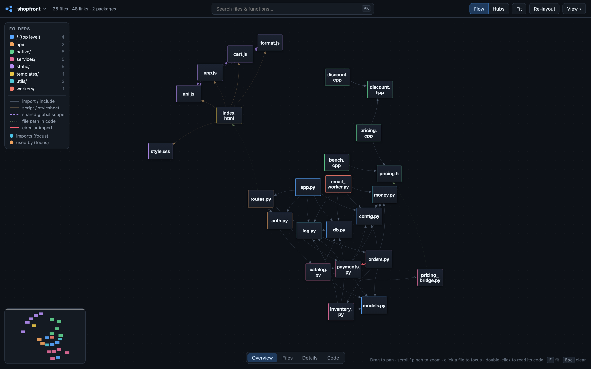
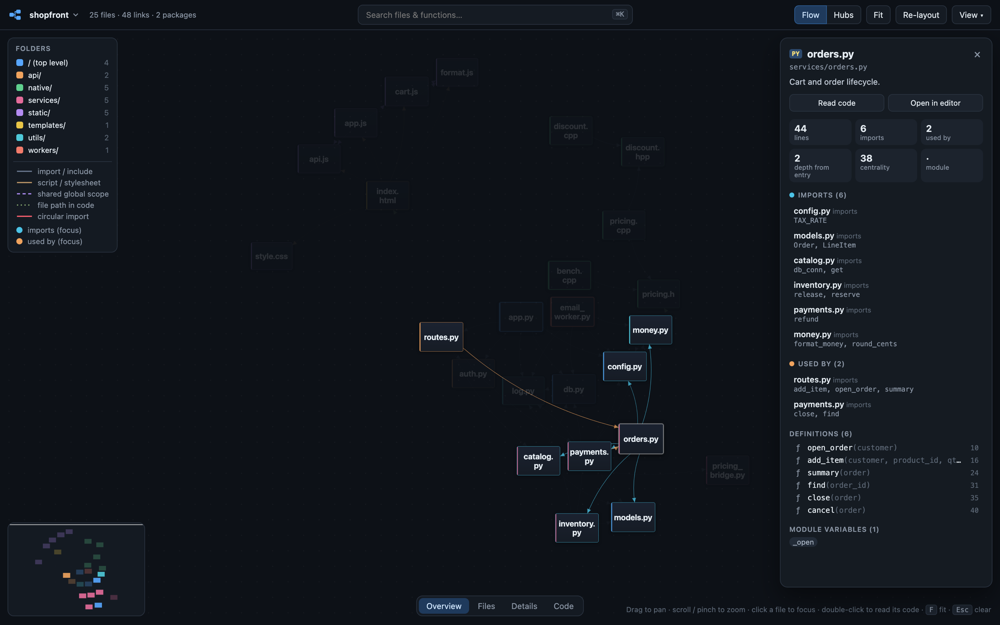
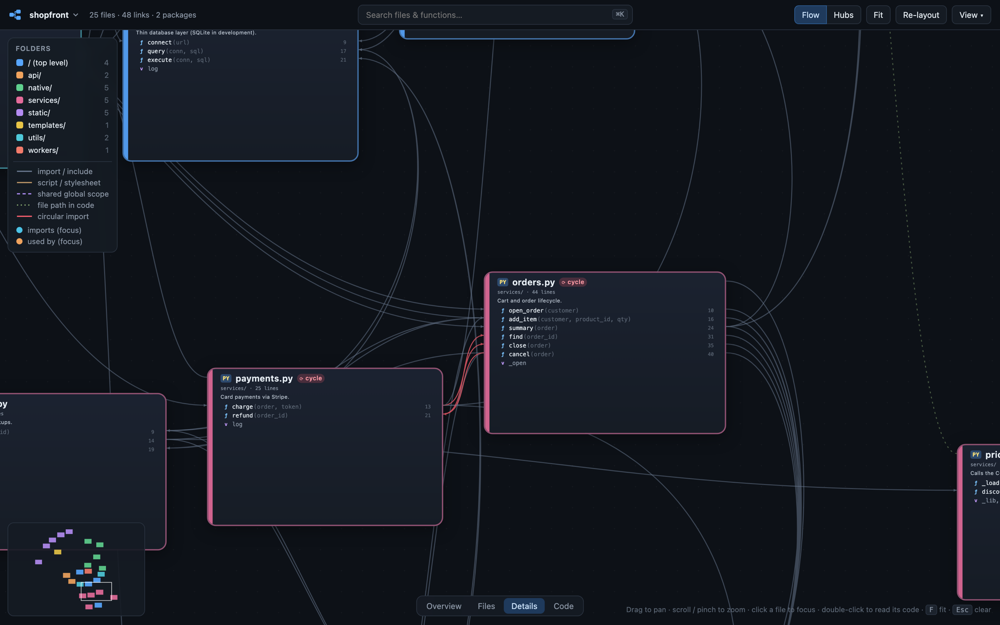
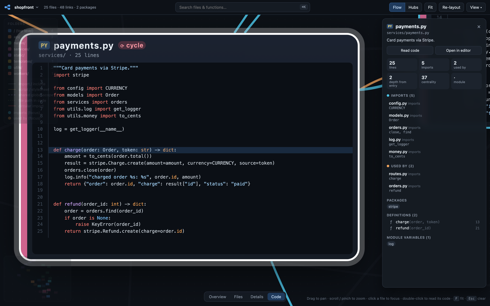
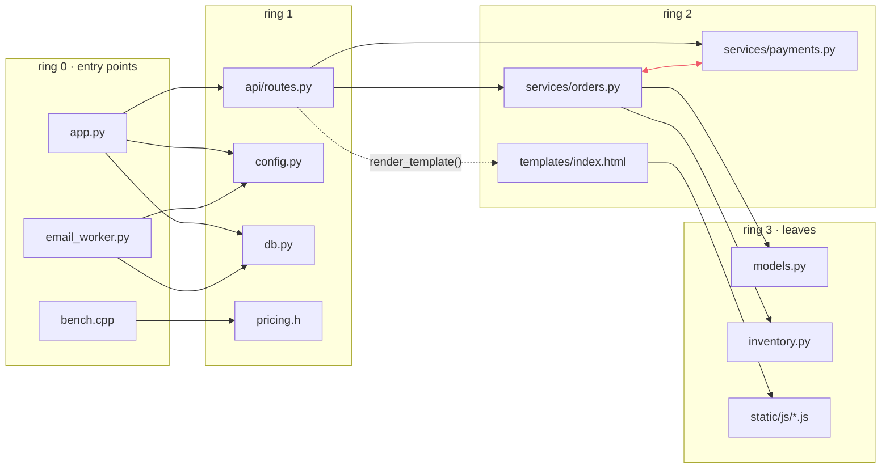
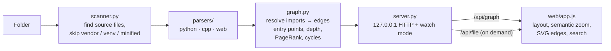

# CodeGraph

**Point it at a folder and get an interactive, zoomable map of how your code connects.**

Files are cards and imports are arrows. Entry points sit in the middle of the map and helper modules radiate outward.
Zoom in and each file shows its functions, with arrows that run *function to function*. Zoom in further and you're reading the source, syntax-highlighted, right inside the card.



<sub>The example project in these screenshots is a small storefront: a Flask API, a plain-JS cart, and a C++ pricing engine called through ctypes.</sub>

- **Zero dependencies.** Pure Python 3.9+ standard library and a vanilla-JS viewer. No `pip install`, no `npm`, no build step.
- **Runs locally.** A tiny server on `127.0.0.1` reads your files; nothing leaves your machine.
- **Python first**, plus C/C++, JavaScript/TypeScript, HTML and CSS in the same map, including links *between* languages.

---

## Quick start

```bash
git clone https://github.com/DBurca/codegraph.git
python3 codegraph/run.py
```

Your browser opens on an **Open a project** screen:

| | |
|---|---|
| **Choose folder…** | The normal macOS / Windows / Linux folder dialog |
| **Browse** | Click through folders or paste a path (`~` works). Folders containing code get a `code` tag; double-click one to map it |
| **Recent** | One click to reopen a project you've mapped before |

Switch projects at any time by clicking the project name in the top-left, or with **⌘O**.
On macOS you can also double-click **`CodeGraph.command`** in Finder.

Already know the folder? Pass it directly:

```bash
python3 run.py ~/code/my-project
```

---

## Four zoom levels

Zooming doesn't just make things bigger: each level shows a different amount of detail (*semantic zoom*).
Jump between levels with the bar at the bottom of the screen, or keys **1–4**.

| Level | Each file shows | Arrows show |
|---|---|---|
| **Overview** | Large, readable file names | which file imports which |
| **Files** | Docstring, import / used-by counts, packages | thickness = how many names are used |
| **Details** | Every class, function and method, with signatures | **function → function**: the arrow leaves the function that makes the call and lands on the function it uses |
| **Code** | The source, syntax-highlighted and scrollable | file → file |

### Focus: click a file

What the file **imports** turns cyan and what **uses it** turns orange; everything else fades.
The side panel lists every link with the exact names involved, plus packages, standard-library imports, and all definitions (click one to jump to its code).



### Details: see which function uses which

At this level each file lists its definitions, and arrows attach to the specific rows.
Below, `payments.charge()` calls `orders.close()` and `payments.refund()` calls `orders.find()`, while `orders.cancel()` calls back into `payments.refund()`.
That's a **circular import**, so those arrows are red and both files carry a `cycle` badge.



### Code: read it in place

Double-click any file, click a function, or pick a function in search, and the camera flies into the card with that line highlighted.
Scrolling inside the card scrolls the code; **Open in editor** jumps to the file in VS Code / Cursor (or your default app).



---

## How the map is laid out

CodeGraph places files on **rings**. In the default **Flow** layout the ring is the number of import hops from an entry point:



- **Entry points**: Python files with `if __name__ == "__main__":`, C/C++ files with `main()`, HTML pages, the `main` field of `package.json`, and unimported files named `main`, `app`, `index`, `server` or `cli`.
- **Rings** are found by breadth-first search outward from the entry points. A `foo.cpp` is placed beside its `foo.h`, since nothing ever `#include`s a `.cpp`.
- **Hubs** (toolbar toggle) instead ranks files by PageRank, putting the most depended-on files (`models.py`, `utils.py`, `config.py`, …) in the middle.
- Within a ring, files are ordered by where their neighbors already sit. A short force simulation then untangles the edges and removes overlaps.
- Cards are colored by top-level folder and sized by line count. Drag cards to rearrange them; **Re-layout** resets.

---

## What it detects

| Language | Method | Links found |
|---|---|---|
| **Python** | the real parser (`ast`) | `import x`, `from x import y`, relative imports, packages and `src/` layouts. It records *which names* each file uses and *on which line*, which is what powers the function-to-function arrows |
| **C / C++** | `#include` + a brace-aware symbol scan | local headers (by relative path, then by unique filename); classes, functions, methods, declarations, macros (including inside `extern "C"`) |
| **JavaScript / TypeScript** | import statements + brace matching | ES modules, `require()`, dynamic `import()`, re-exports, `@/` aliases, `.js` → `.ts` |
| **HTML** | tags and attributes | `<script src>`, stylesheets, inline scripts, `onclick=` handlers, Flask/Jinja `url_for('static', filename=…)` |
| **Plain browser scripts** | shared global scope | scripts loaded by the same page that call each other's top-level functions (dashed purple arrows) |
| **Any language** | string literals naming project files | `render_template("index.html")`, Electron `loadFile(...)`, `"native/pricing.h"`… (dotted green arrows) |

| Arrow style | Meaning |
|---|---|
| solid gray | import / `#include` |
| solid tan | `<script>` / stylesheet |
| dashed purple | shared global scope between scripts |
| dotted green | file path mentioned in code |
| **red** | circular import |

External packages (`numpy`, `flask`, `axios`, CDN scripts…) are listed per file, and can be shown as their own nodes via **View → External packages**. Standard-library imports are kept separate so they don't clutter the graph.

**Skipped automatically:** `node_modules`, virtualenvs, `__pycache__`, `dist/` and `build/`, hidden folders, minified bundles, empty `__init__.py`, browser "Save page as…" `*_files/` folders, and files over 1.5 MB. Very large folders (for example a home directory) are capped at 3,000 files.

---

## Everything you can do

| Action | How |
|---|---|
| Pan | drag the background, or two-finger scroll on a trackpad |
| Zoom | pinch, ⌘/Ctrl + scroll, `+` / `−`, or the level bar / keys `1`–`4` |
| Focus a file | click it (`Esc` clears) |
| Read code | double-click a file, or click a function at Details level |
| Search files & functions | `⌘K` or `/`, arrow keys, `Enter` |
| Fit everything | `F` |
| Show / hide a folder | click it in the legend; double-click to show only that folder |
| Switch project | click the project name, or `⌘O` |
| Toggle layers | **View** menu: unconnected files, external packages, stylesheets, shared-global links, file-path links, transitive focus, scroll behavior |
| Live reload | automatic: save a file and the map updates in place |
| Share a view | the URL updates as you click (`#select=services/orders.py`); see below |

**Scroll wheel:** on macOS it pans by default (trackpad style). If you use a mouse, choose **View → Scroll wheel → zooms**.

### Linkable views

The URL hash controls the view, which is handy for bookmarks, docs, or scripted screenshots (the images above were made this way with headless Chrome):

| Hash | Effect |
|---|---|
| `#select=api/routes.py` | focus a file |
| `#code=services/payments.py&line=13` | open a file's code at a line |
| `#at=services/orders.py&k=1.4` | center the camera on a file at zoom `k` (`dx`/`dy` nudge it) |
| `#mode=hubs` | use the Hubs layout |

---

## Command line

```
python3 run.py [FOLDER] [--port 8765] [-x GLOB ...] [--no-browser] [--no-watch] [--json out.json]
```

| Option | |
|---|---|
| `FOLDER` | project to map; omit it to choose one in the browser |
| `-x GLOB` | skip matching files or folders, repeatable: `-x 'tests/*' -x 'maintenance/*'` |
| `--port` | first port to try (moves up if busy) |
| `--no-browser` | don't open a browser tab |
| `--no-watch` | don't live-reload on file changes |
| `--json FILE` | write the graph as JSON and exit, for your own tooling |

The JSON has `nodes` (path, language, lines, symbols with line ranges, depth, PageRank, entry/cycle flags, external packages) and `edges` (source, target, kinds, names used, `[line, name]` usage pairs).

---

## How it works



- **Parsing.** Python uses the standard-library `ast`, so imports and usages are exact. C-family and web languages use comment- and string-aware scanning with brace matching: fast and dependency-free, but heuristic (see the limits below).
- **Resolution** mirrors each language's rules: Python searches the importing file's folder and its parents (script-style and package-style imports both work); JS tries extensions and `index` files; C++ tries relative paths, then a unique filename match.
- **Viewer.** Cards are HTML inside one CSS-transformed layer, and arrows are SVG paths recomputed each frame. The zoom factor selects the level, and CSS swaps what each card shows. Code is fetched only for cards on screen at Code level, then highlighted with highlight.js.
- **Watch mode** polls file timestamps every 1.5 s and re-parses only the files that changed.
- **Safety.** The server only listens on `127.0.0.1`, answers only requests whose `Host` is itself (blocking other websites and DNS-rebinding tricks), and requires JSON bodies for anything that acts (opening a project or editor).

### Repository layout

```
run.py                   launcher (python3 run.py [folder])
CodeGraph.command        macOS double-click launcher
codegraph/
  __main__.py            command-line interface
  scanner.py             find source files; skip vendor, venv, minified, huge folders
  graph.py               import resolution, entry points, depth rings, PageRank, cycles
  server.py              local HTTP API, folder browser / native picker, watch mode
  parsers/
    python_parser.py     ast-based: imports, symbols, per-line name usage
    cpp_parser.py        #include + class / function / declaration scan
    web_parser.py        JS / TS / HTML / CSS
    clike.py             shared comment / string stripping and brace matching
  web/
    index.html  style.css  app.js     the viewer
docs/screenshots/        images used in this README
```

---

## Limits

- **Heuristic outside Python.** Unusual C++ (heavy macros, templates spanning lines) or JS (regex literals containing quotes) may hide a symbol or two. Imports and includes themselves are reliable.
- **Static only.** Imports built at runtime (`importlib.import_module(name)`), dependency injection, and calls through objects (`self.repo.save()`) can't be traced to a specific file.
- **Size.** The map is happiest up to a few hundred files. For larger repos, use the folder legend or `-x` to focus on one part.
- The Code level wants a reasonably large window; on small screens the card can be wider than the view.

## Ideas / roadmap

- Collapse a folder into a single group node, expanded by clicking (for big repos)
- Ignore-folders setting in the GUI, remembered per project
- Git overlay: color by recent changes or churn, or highlight what a branch touched
- More languages (Go, Rust, Java) via the same parser interface

## License

[MIT](LICENSE)
